# Principal Review — Website Language & Section Changes

**Reviewer lens:** Dr. Priya Nair, Principal, Greenfield International School (Tier‑1 CBSE, Bangalore, 1,800 students, Pre‑K–Grade 10). Found the site on her own and is deciding whether to book a call.
**Scope:** Copy and section structure only. No code changes.
**Reviewed:** 9 Oct 2026, desktop build. Unless an item says otherwise, a change applies to **both builds** (desktop + `m/`).
**Screenshots:** in [`principal-review/`](principal-review/).

### How to track
- Tick the checkbox on each item and update the **Status** column in the tracker.
- Status values: `To do` · `In progress` · `Done` · `Won't do`
- **Priority:** **P1** = would stop me booking a call · **P2** = weakens the case I'd make to my Management Committee · **P3** = polish
- ⚠️ **Confirm** = the recommended copy states a fact Tilli needs to verify before publishing. Don't ship a ⚠️ line until someone has confirmed it.

---

## Dr. Nair's first read (in character)

> "I'd give this site about ninety seconds. The scroll is beautiful, but I got to the dots before I found out what Tilli actually *is* or which grades it's for. And 'on track by 10': is that age 10 or Grade 10? If it's Grade 10, it's touching my board classes, and I'd close the tab.
>
> The best content on this site is the FAQ. Real prices, real teacher hours, an honest answer on evidence. But it isn't in the header. I only found it in the footer.
>
> Three things would make me hesitate. The pilot is described two different ways. One page says 'Tilli works' and another says the evidence is still being built. And the Success page has notes on it that read like internal drafts.
>
> Fix those, show me a real dashboard, and name one school that looks like mine. Then I'd book the 30 minutes."

### Top 5 if you only do five
1. **GL-07** Say the grade range clearly ("by age 10", Pre‑K–Grade 5).
2. **GL-03 / GL-04** Fix the pilot-terms contradiction and the evidence contradiction.
3. **HM-14** Add a "What it asks of your school" section: time, training, cost, timetable.
4. **SC-04 / SC-05** Remove the internal-sounding notes on the Success page.
5. **GL-01** Put FAQs & pricing in the header.

---

## Tracker

| ID | Page | Section | Change (short) | Type | Pri | Status |
|---|---|---|---|---|---|---|
| GL-01 | Global | Header nav | Add How it works / Pricing & FAQs to header | Section | P1 | To do |
| GL-02 | Global | CTAs | One name for the primary CTA site-wide | Language | P2 | To do |
| GL-03 | Global | Pilot offer | Reconcile "one term" vs "one year" | Language | P1 | To do |
| GL-04 | Global | Evidence claims | Reconcile "Tilli works" with "evidence still being built" | Language | P1 | To do |
| GL-05 | Global | Framework name | "Analyze" vs "Ask": pick one | Language | P2 | To do |
| GL-06 | Global | Definitions | Define SEL / foundational skills once, plainly | Language | P2 | To do |
| GL-07 | Global | Tagline / grades | "On track by 10": say age 10 and Pre‑K–5 | Language | P1 | To do |
| GL-08 | Global | Local context | Indian-context wording, phone number, spelling | Language | P2 | To do |
| GL-09 | Global | Recognition | Add HundrED / other recognition if true ⚠️ | Language | P2 | To do |
| GL-10 | Global | Naming | "Ask-Tilli" vs "Ask Tilli" | Language | P3 | To do |
| GL-11 | Home | Scene nav pills | Rename "Views", "Journey", "Progress" | Language | P3 | To do |
| HM-01 | Home | Hero (beat A) | Lead with the principal's real question | Language | P1 | To do |
| HM-02 | Home | Hero (beat B) | Clarify "They… that child… 579" | Language | P1 | To do |
| HM-03 | Home | Dashboard | Show a real dashboard, not an illustration | Section | P1 | To do |
| HM-04 | Home | Reports | Answer the parent's real question | Language | P2 | To do |
| HM-05 | Home | 3 people | "Matter most" → "know the child best" | Language | P3 | To do |
| HM-06 | Home | Teacher strand | Promote the workload line, use real class size | Language | P1 | To do |
| HM-07 | Home | 12 skills | Plain-language grouping + NEP/HPC mapping ⚠️ | Language | P2 | To do |
| HM-08 | Home | On track | Remove headline/sub contradiction | Language | P2 | To do |
| HM-09 | Home | AI compare | Add a privacy line under the Tilli answer | Language | P1 | To do |
| HM-10 | Home | Live demo | 35 per class, leader-style prompts | Language | P2 | To do |
| HM-11 | Home | 53 schools | Add where / which boards; fix placeholder carousel | Both | P1 | To do |
| HM-12 | Home | Stats + quote | Outcome stats on Home; fix quote label | Both | P2 | To do |
| HM-13 | Home | Partner schools did | Reframe as "A year with Tilli" | Both | P2 | To do |
| HM-14 | Home | **New section** | "What it asks of your school" | Section | P1 | To do |
| HM-15 | Home | **New section** | "Works with what you already have" | Section | P2 | To do |
| HM-16 | Home | Closing CTA | Lead with the pilot; name the founder | Language | P1 | To do |
| SC-01 | Success | Hero | Replace "reshaping thousands of childhoods" | Language | P2 | To do |
| SC-02 | Success | Tilli works | Retitle; adoption ≠ training rating; add sources | Language | P1 | To do |
| SC-03 | Success | Hippocampus | Say what the 28% is and who reported it | Language | P2 | To do |
| SC-04 | Success | NMAJS | Remove internal note; update stale dates | Language | P1 | To do |
| SC-05 | Success | Musaeus | Remove internal note | Language | P1 | To do |
| SC-06 | Success | **New story** | A school like mine (CBSE, metro) ⚠️ | Section | P1 | To do |
| SC-07 | Success | Photos | Replace placeholder images | Asset | P1 | To do |
| SC-08 | Success | Contact block | India/WhatsApp number; de-duplicate | Language | P2 | To do |
| SC-09 | Success | Final CTA | Add the pilot offer | Language | P2 | To do |
| FQ-01 | FAQ | Hero | Address school leaders directly | Language | P3 | To do |
| FQ-02 | FAQ | **New questions** | 9 missing principal questions | Section | P1 | To do |
| FQ-03 | FAQ | Time per teacher | Replace "won't claim this replaces something" | Language | P2 | To do |
| FQ-04 | FAQ | Cost | Use a sections × class-size example | Language | P3 | To do |
| FQ-05 | FAQ | Order | Move "time per teacher" to #2 | Section | P3 | To do |
| RS-01 | Research | Top | Signpost for school leaders | Section | P2 | To do |
| RS-02 | Research | Headings | Remove exclamation marks | Language | P2 | To do |
| RS-03 | Research | Open dataset | Consent statement for partner-school data ⚠️ | Language | P1 | To do |
| RS-04 | Research | 12 skills | Match skill names to Home | Language | P2 | To do |
| RS-05 | Research | Copy fixes | PIN code, grammar, link labels | Language | P3 | To do |
| RS-06 | Research | About the team | Name the same partners as Home | Language | P2 | To do |

---

## GLOBAL (site-wide)

### GL-01 · Header nav · P1 · Section
- [ ] Done

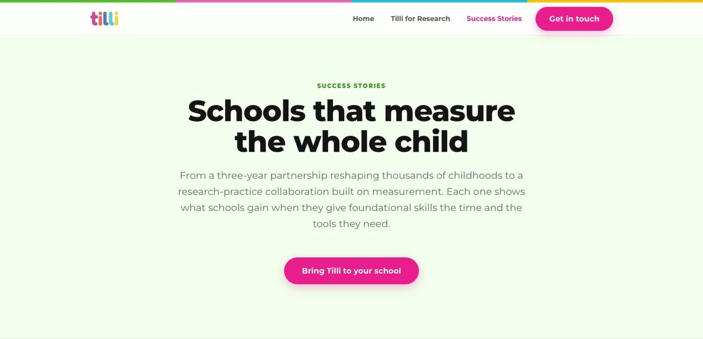

**Current:** `Home · Tilli for Research · Success Stories · [Get in touch]`
**Recommended:** `How it works · Results · Pricing & FAQs · For researchers · [Book a 30-min call]`

**Why (Dr. Nair):** "The answers I need, like cost, teacher hours and evidence, are in your FAQ, and I only found it in the footer. Research is the second item in your header, but researchers aren't who's buying."

---

### GL-02 · One primary CTA name · P2 · Language
- [ ] Done

**Current (7 variants):** "Book a demo", "Book a demo →", "Get in touch", "Bring Tilli to your school", "Let's talk about your school", "Get the parent one-pager →", plain email links.
**Recommended:** Use three CTAs only, with the same wording everywhere.
| Role | Label |
|---|---|
| Primary | **Book a 30-minute call** |
| Low-commitment | **Download the school leader one-pager** *(new asset, written for my Management Committee)* |
| Pilot | **Start with a pilot** |

**Why:** "'Demo' makes me think of a sales pitch. '30-minute call' tells me exactly how much time I'm giving."

---

### GL-03 · Pilot terms contradict · P1 · Language ⚠️
- [ ] Done

**Current:**
- Home closing CTA: *"Start with a pilot — one grade, one term, your data, your pace."*
- FAQ cost answer: *"One grade for one year is our smallest engagement."*

**Recommended:** Decide on one offer and use identical wording everywhere. For example: *"Start with one grade for one term. If the data doesn't show you something useful, you stop there."* If the real minimum is one year, say *"one grade, one year, with a full review after Term 1."*

**Why:** "If two pages give me two different pilots, I assume the smaller one goes away when I sign."

---

### GL-04 · Evidence claims contradict · P1 · Language
- [ ] Done

**Current:**
- Success: heading *"Tilli works"*, *"9 in 10 children improved emotion regulation in a single term."*
- FAQ: *"The programme's outcome evidence is still being built, and we'd rather tell you that than show you someone else's research."*

**Recommended:** Keep the FAQ's honesty. It's the most persuasive line on the site. On Success and Home, give every outcome number a source and say who reported it: *"9 in 10 children improved in emotion regulation in one term (teacher-reported, [N] children, [schools], 2025–26)."* Retitle "Tilli works" (see SC-02).

**Why:** "My parent representatives are doctors and engineers. They'll find the FAQ line, and then every other number on the site loses credibility."

---

### GL-05 · Framework name · P2 · Language
- [ ] Done

**Current:** The hero eyebrow says *"MEASURE · ANALYZE · INTERVENE"*. Everywhere else says *"Measure. Ask. Intervene."*
**Recommended:** *"MEASURE · ASK · INTERVENE"* everywhere.

---

### GL-06 · Define SEL / foundational skills once · P2 · Language
- [ ] Done

**Current:** "SEL" first appears in *"…and the SEL Teaching Kit"* with no definition. "Foundational skills" is never defined either.
**Recommended:** Add this line the first time the term appears on Home (the 12-skills section):
> *"Foundational skills are the attention, memory, self-control and people skills that decide how well a child learns everything else. Researchers call the emotional half social-emotional learning (SEL)."*

**Why:** "My Management Committee chairman is in real estate. If I say 'SEL' he hears 'soft'. If I say 'attention and self-control that predict marks', he listens."

---

### GL-07 · "On track by 10" is ambiguous · P1 · Language ⚠️
- [ ] Done

**Current:** Footer and page title read *"Developmentally on track by 10."* No page states the grade range.
**Recommended:**
- Tagline: *"Developmentally on track by **age** 10."*
- Add a line near the top of Home: *"Built for Pre‑K to Grade 5 (ages 3–10)."* ⚠️ confirm the range.
- Turn it into a reassurance in HM-14: *"Tilli never touches your board-exam classes."*

**Why:** "In a CBSE school, '10' means Grade 10 boards. I read your tagline as 'we'll be in your Grade 10 classrooms', and that's my most sensitive year."

---

### GL-08 · Indian context · P2 · Language
- [ ] Done

| Where | Current | Recommended |
|---|---|---|
| Success contact block | Only *+1 650‑334‑7904* | Add an Indian number or WhatsApp line for schools ⚠️ |
| Research → Ecological predictors | "Zip code of the school", "Home zip code" | "PIN / postal code" |
| Site-wide spelling | "Analyze" alongside "behaviour", "Organisation" | Use British/Indian spelling throughout ("Analyse", "programme") |

**Why:** "A US number tells me support is on the other side of the world."

---

### GL-09 · Recognition strip · P2 · Language ⚠️
- [ ] Done

**Current:** *"INCUBATED AT STANFORD · SCALED WITH UNICEF INNOVATION"*. Good.
**Recommended:** If Tilli has HundrED or any Indian or government recognition, add it to this strip and to the school leader one-pager. ⚠️ Only add recognition Tilli actually holds.

**Why:** "My committee recognises these names. That one line does more for me than a paragraph of explanation."

---

### GL-10 · "Ask-Tilli" vs "Ask Tilli" · P3 · Language
- [ ] Done

**Current:** "ASK-TILLI · KNOWS DHRUV'S DATA" and "Ask Tilli anything about your school" appear in the same scroll.
**Recommended:** Use one spelling for the product name ("Ask-Tilli"). The sentence "Ask Tilli anything" can stay as a verb phrase if you want, but check that it reads as intended.

---

### GL-11 · Home scene-nav pill labels · P3 · Language
- [ ] Done

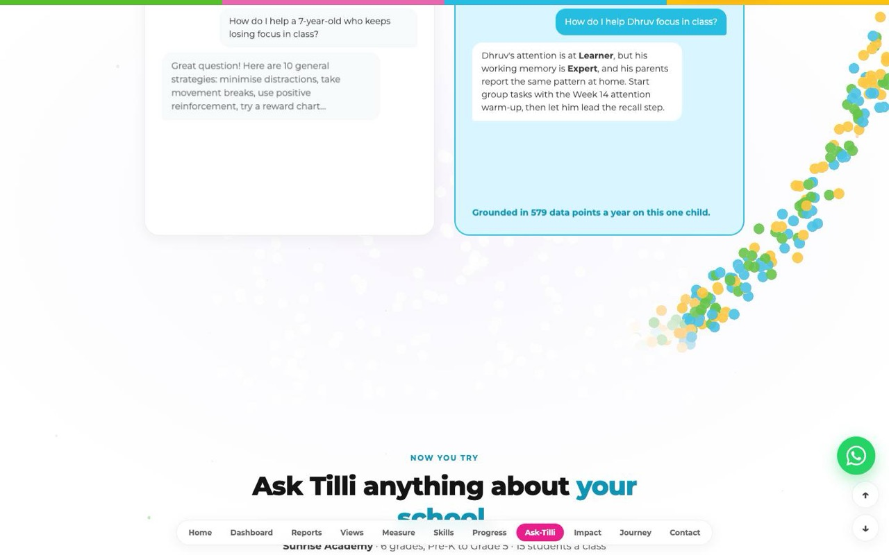

**Current:** `Home · Dashboard · Reports · Views · Measure · Skills · Progress · Ask-Tilli · Impact · Journey · Contact`
**Recommended:** `Start · Dashboard · Reports · 3 perspectives · Measure · 12 skills · On track · Ask-Tilli · Schools · A year with Tilli · Talk to us`

**Why:** "'Views' and 'Journey' are your internal labels. I don't know what's behind them, so I won't click."

---

## HOME (`index.html`)

### HM-01 · Hero, beat A · P1 · Language
- [ ] Done

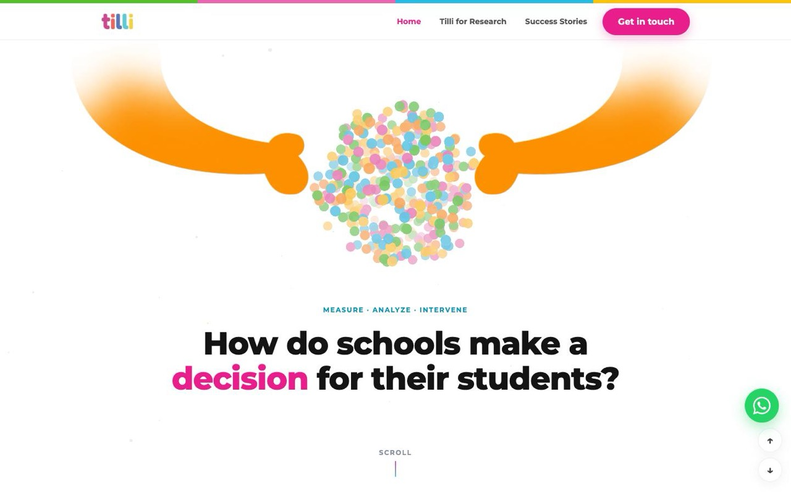

**Current:** Eyebrow *"MEASURE · ANALYZE · INTERVENE"*. H1 *"How do schools make a **decision** for their students?"*

**Recommended (keeps the two-beat question → answer structure):**
- Eyebrow: *"FOR SCHOOL LEADERS · PRE‑K TO GRADE 5"*
- H1: *"How do you know which children are quietly **falling behind**?"*

**Why:** "Your question implies schools don't already make decisions. Mine is that I only find out from marks, and by then it's Term 3. Ask *my* question and I'll keep scrolling."

---

### HM-02 · Hero, beat B · P1 · Language
- [ ] Done

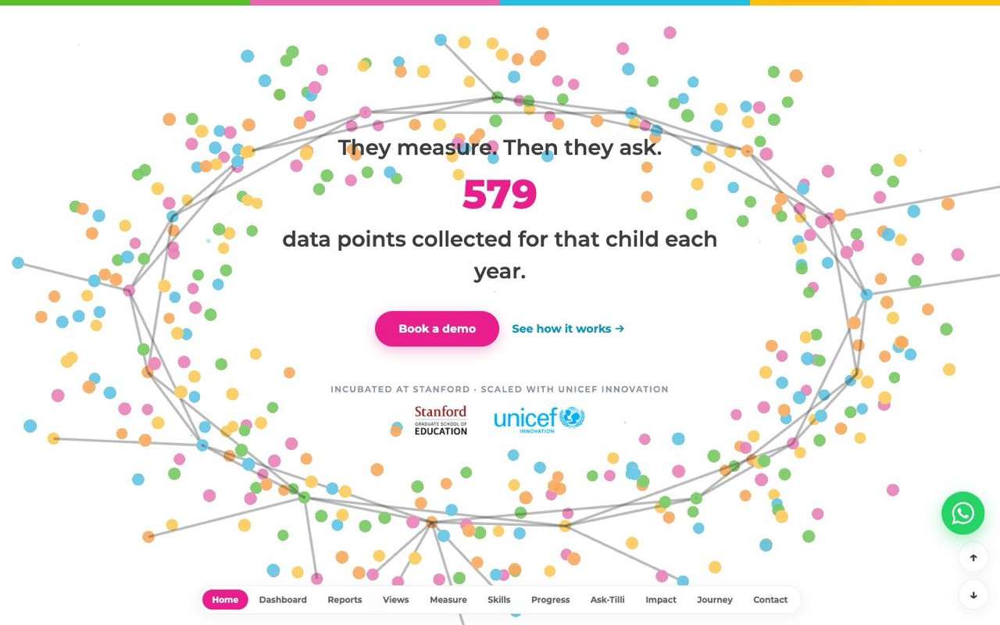

**Current:** *"They measure. Then they ask. **579** data points collected for that child each year."*
**Recommended:**
> *"Most schools find out from marks. Tilli measures each child three ways, three times a year: **579** data points per child, in about 5 minutes of class time per child each term."*

**Why:** "'They' and 'that child' don't refer to anyone. And 579 on its own makes me think of 579 forms for my teachers. Put the time cost next to the number."

---

### HM-03 · Dashboard · P1 · Section
- [ ] Done

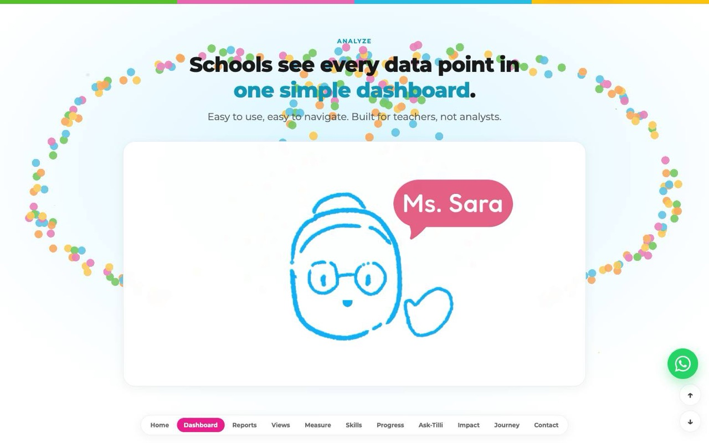

**Current:** *"Schools see every data point in one simple dashboard."* The visual is an illustrated teacher avatar ("Ms. Sara"), not a dashboard.
**Recommended:**
- **Section:** Show a real (demo-data) dashboard screen, such as a grade × skill heat-map with a Term 1 → Term 2 change.
- H2: *"See every class at a glance, and which children need help first."*
- Sub: *"Grade by grade, skill by skill, term over term. Built for teachers, not analysts."*

**Why:** "I've seen a hundred slides *about* dashboards. Show me the screen I'd open on a Monday morning."

---

### HM-04 · Reports · P2 · Language
- [ ] Done

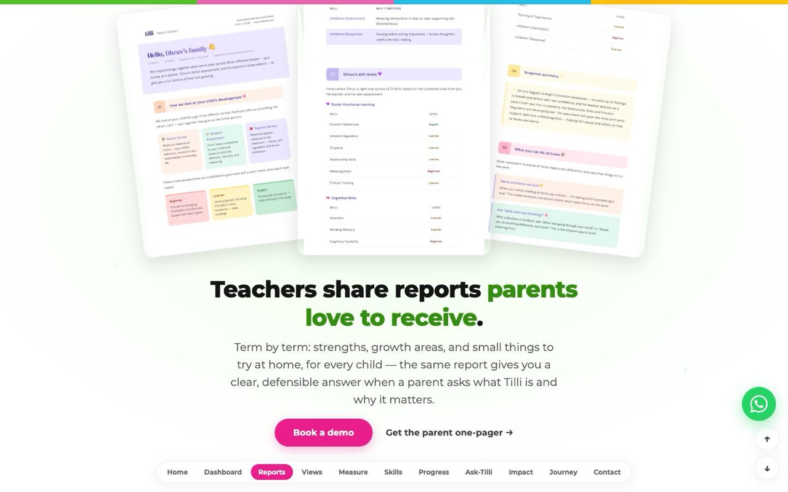

**Current:** *"…the same report gives you a clear, defensible answer when a parent asks what Tilli is and why it matters."*
**Recommended:**
> *"Term by term: strengths, growth areas, and two or three things to try at home. No scores out of ten, no ranking against classmates, and in the language your parents read. It's the answer when a parent asks, 'Why is school spending time on this?'"*

Add a second link beside "Get the parent one-pager": **"Get the school leader one-pager"**.

**Why:** "The 'no ranking' line is in your FAQ. That's exactly what calms my parents, so bring it up here."

---

### HM-05 · Three people · P3 · Language
- [ ] Done

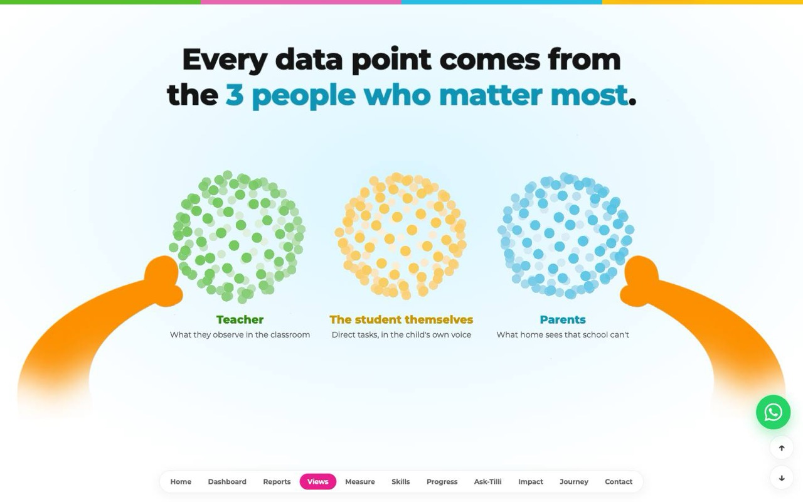

**Current:** *"Every data point comes from the 3 people who matter most."*
**Recommended:** *"Every data point comes from the 3 people who know the child best."*

**Why:** It's more accurate and less sentimental, and "know best" explains why you ask these three people.

---

### HM-06 · Teacher strand: workload line is buried · P1 · Language
- [ ] Done

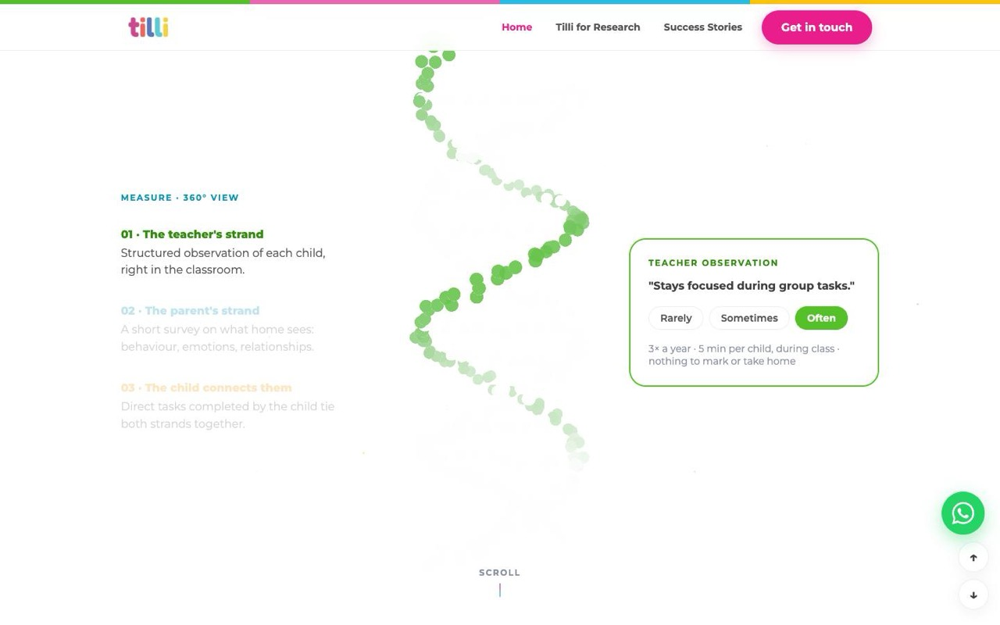

**Current (small grey text inside the card):** *"3× a year · 5 min per child, during class · nothing to mark or take home"*
**Recommended:** Make this line the bold lead of the Measure section, and do the maths for an Indian class size:
> *"About 5 minutes per child, during class, three times a year. For a class of 35, that's roughly 3 hours a term, with nothing to mark or take home."*

Make the FAQ number match. The FAQ currently says "about 2.5 hours", which assumes about 30 children.

**Why:** "I lost four senior teachers to burnout last year. Workload is the first thing I look for, and you've put it in the smallest text on the page."

---

### HM-07 · 12 skills · P2 · Language ⚠️
- [ ] Done

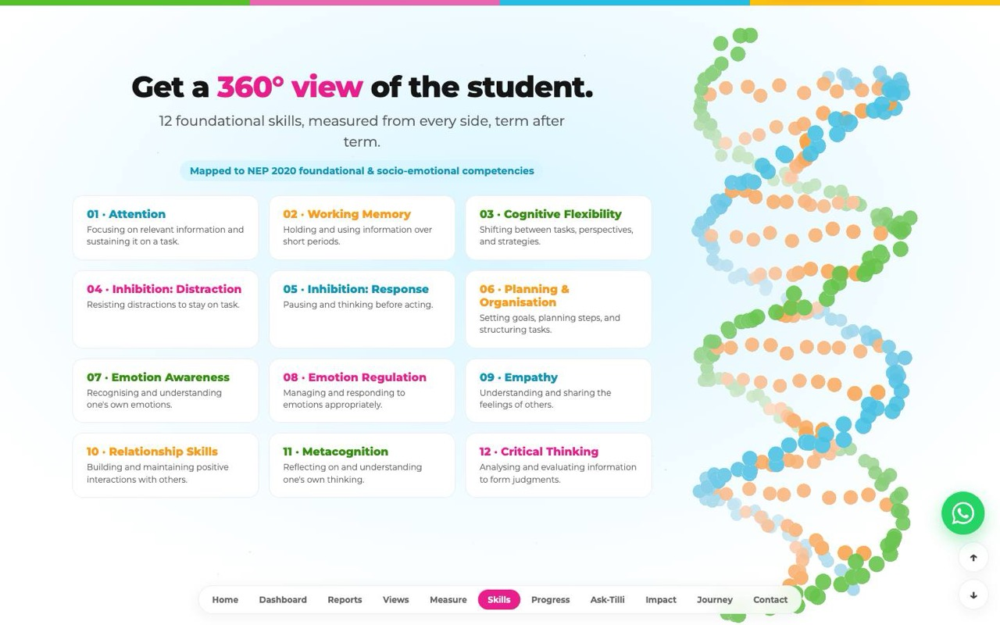

**Current:** A flat list of 12 technical labels ("Inhibition: Distraction", "Metacognition"…). The NEP line is a small pill.
**Recommended:**
- Group the skills under two plain headers: **"Thinking skills: how a child learns"** (01–06, 11–12) and **"People skills: how a child feels and gets along"** (07–10). ⚠️ Confirm the grouping with the curriculum team.
- Promote the NEP line to a full sentence: *"Mapped to NEP 2020 and NCF‑FS socio-emotional competencies. Your Tilli reports can feed the CBSE Holistic Progress Card."* ⚠️ Only include the HPC claim if it's true.
- Add the GL-06 definition here.

**Why:** "Every CBSE principal is working on the Holistic Progress Card right now. If you help me fill it in, you're solving a problem I already have."

---

### HM-08 · "Developmentally on track" · P2 · Language
- [ ] Done

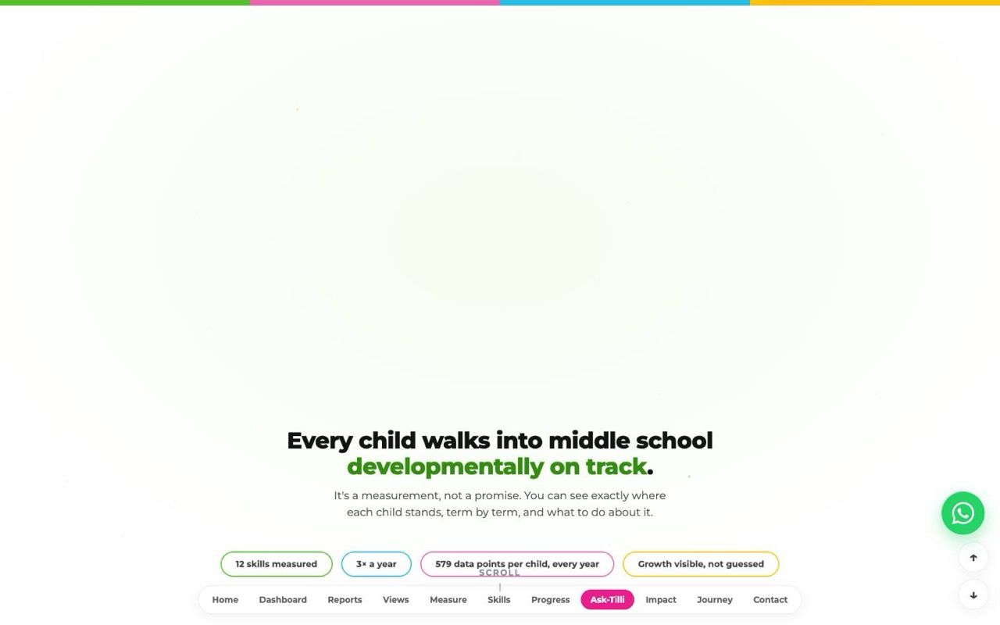

**Current:** H2 *"Every child walks into middle school developmentally on track."* Sub *"It's a measurement, not a promise…"*
**Recommended:**
- H2: *"Know, term by term, whether every child is **on track** for middle school."*
- Sub: *"See where each child stands, how far they've moved since last term, and what to do next."*

**Why:** "The headline reads as a promise, and the next line says it isn't one. Put the honest version in the headline."

---

### HM-09 · Generic AI vs Ask-Tilli · P1 · Language
- [ ] Done

**Current:** A strong comparison. Under the Tilli card: *"Grounded in 579 data points a year on this one child."*
**Recommended:** Add a reassurance line directly underneath:
> *"Children are identified by school ID, never by name. You can switch Ask-Tilli off for your school at any time, and everything else keeps running."* (Taken from the FAQ.)

**Why:** "The moment I read 'knows Dhruv's data', I'm thinking about data privacy. Answer that worry right where it comes up."

---

### HM-10 · Live demo · P2 · Language
- [ ] Done

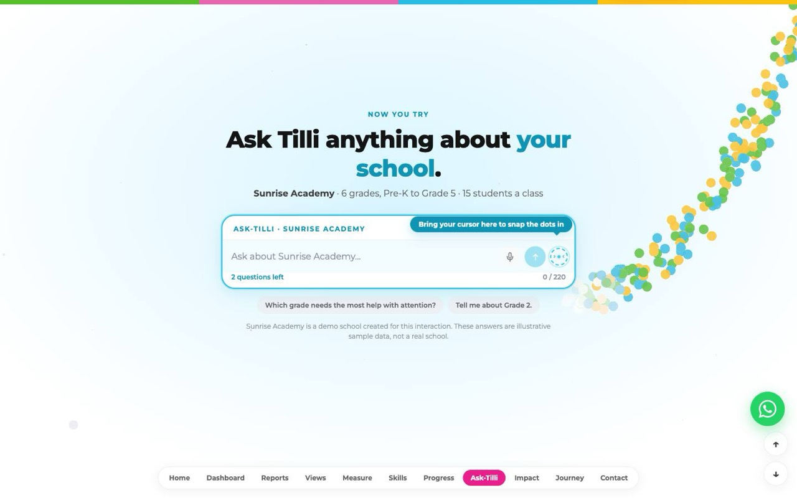

**Current:** *"Sunrise Academy · 6 grades, Pre‑K to Grade 5 · **15 students a class**"*. Helper text: *"Bring your cursor here to snap the dots in"*. Prompts: "Which grade needs the most help with attention?", "Tell me about Grade 2."
**Recommended:**
- *"…· **35 students a class**"*
- Helper text: *"Try it: ask a question below."*
- Add leader-style prompts: *"What should I tell Grade 3 parents at the PTM?"* and *"How has Grade 2 changed since Term 1?"*

**Why:** "Fifteen to a class isn't an Indian school. I have 38. Show me it works at my size."
*Note: the scripted demo answers will need to match the new class size and prompts.*

---

### HM-11 · "53 schools" · P1 · Both
- [ ] Done

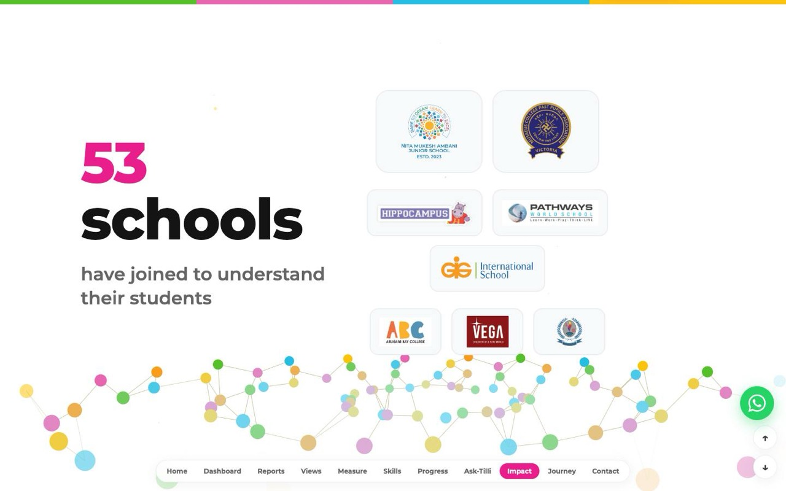

**Current:** *"53 schools have joined to understand their students"* above a row of logos.
**Recommended:**
- *"53 schools across India and Sri Lanka, from CBSE and ICSE to IB and Cambridge, have joined."* ⚠️ Confirm the board mix.
- Put a small city/board caption under each logo (e.g. "Mumbai · IB").

**Why:** "The first thing I'll ask is whether there's a school like mine: CBSE, a metro, 35 to a class. Help me find it in the logo row."

---

### HM-12 · Stats + quote · P2 · Both
- [ ] Done

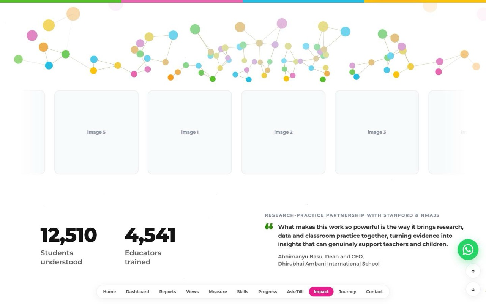

**Current:**
- The carousel shows **placeholder tiles "image 1…5"** (asset gap, P1 to fix before launch).
- *"12,510 Students understood · 4,541 Educators trained"*
- Label *"Research-Practice Partnership with Stanford & NMAJS"* sits above a quote attributed to *Abhimanyu Basu, Dean and CEO, **Dhirubhai Ambani International School***.

**Recommended:**
- *"12,510 children assessed"* ("understood" reads oddly).
- Add one or two **outcome** stats here, with sources (see GL-04). Right now outcome numbers appear only on the Success page.
- Explain how NMAJS and DAIS are connected in the label, or give the quote its own label. ⚠️
- Add a second short quote from a **teacher** about the classroom or workload.

**Why:** "The quote is about research. My committee wants to hear from a teacher who's still using it in February."

---

### HM-13 · "What our partner schools did" · P2 · Both
- [ ] Done

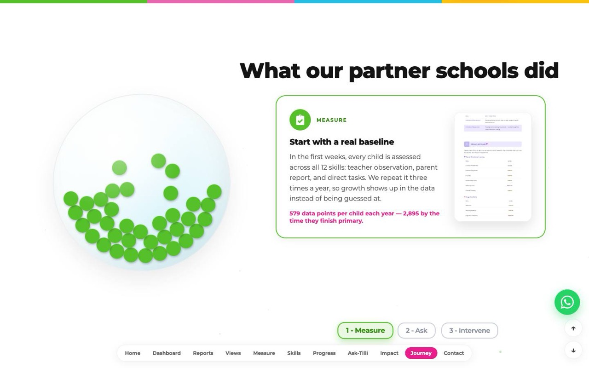
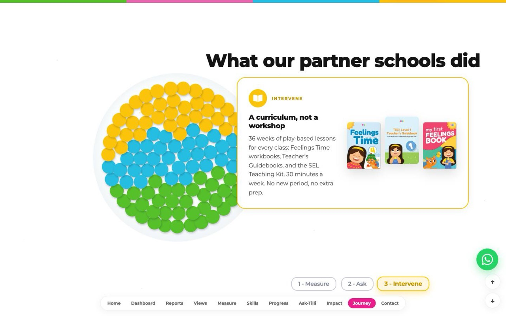

**Current:** H2 *"What our partner schools did"*, then Measure → Ask → Intervene cards. *"…2,895 by the time they finish primary."* *"…and the SEL Teaching Kit."*
**Recommended:**
- H2: *"What a year with Tilli looks like"*
- Anchor each step to the Indian academic year: *"June: baseline across all 12 skills · Every week: one 30-minute lesson · End of each term: reassessment and parent reports · March: a year-end report for your Management Committee and Annual Report."* ⚠️ Confirm the cadence.
- "2,895 by the time they finish primary" → *"…2,895 over five years."* (579 × 5. Make sure "five years" matches the grade range.)
- Define the SEL Teaching Kit, or rename it "Teaching Kit".

**Why:** "My budget cycle runs April to March. Show me your year laid over mine."

---

### HM-14 · NEW SECTION: "What it asks of your school" · P1 · Section
- [ ] Done

**Placement:** after "A year with Tilli", before the closing CTA.
**Recommended content** (all from the FAQ, made scannable):

| | |
|---|---|
| **Training** | 2 days, once. Nothing mandatory after. |
| **Assessment** | ~5 min per child, in class, 3× a year |
| **Lessons** | 30 min a week, inside an existing period (e.g. Life Skills) |
| **Teacher prep** | None. Lessons are ready to teach. |
| **Board-exam classes** | Untouched. Tilli runs Pre‑K to Grade 5. ⚠️ |
| **Cost** | From ₹1,600 per child per year. One grade of 60 is about ₹1.8 lakh. |

H2: *"What Tilli asks of your school."* Sub: *"Fewer surprises at the Parent‑Teacher Meet. Nothing new on the timetable."*

**Why:** "This table *is* my one-slide brief for the Management Committee. Right now I'd have to put it together myself from the FAQ."

---

### HM-15 · NEW SECTION: "Works with what you already have" · P2 · Section
- [ ] Done

**Placement:** near the 12 skills or the Ask-Tilli section.
**Recommended copy:**
> **"Tilli doesn't replace your counsellor. It tells them which children to see first."**
> Your Life Skills period gets a 36-week plan. Your values assembly gets a skills language your teachers share. Your counsellor gets early signals, not end-of-term referrals.

**Why:** "My first objection is that we already have a counsellor and a values programme. Answer it before I ask."

---

### HM-16 · Closing CTA · P1 · Language
- [ ] Done

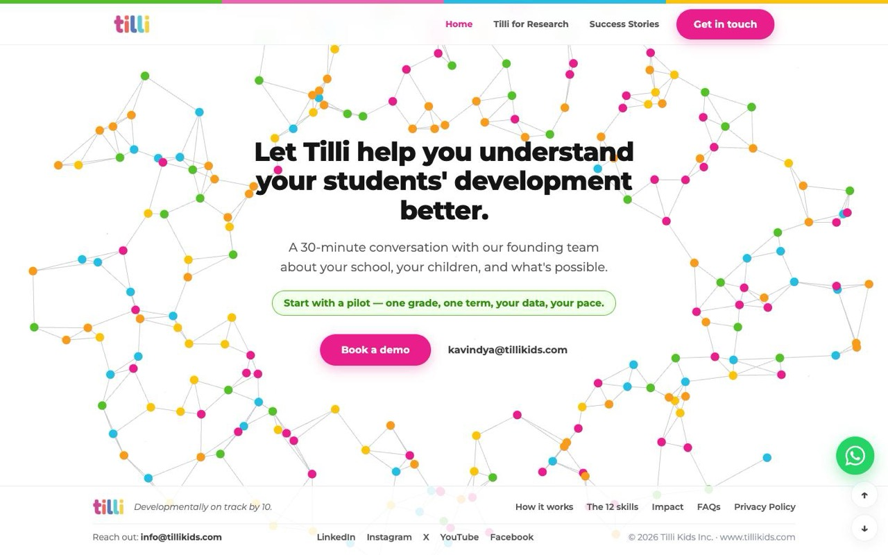

**Current:** H2 *"Let Tilli help you understand your students' development better."* The pilot appears only as a small pill. A bare *kavindya@tillikids.com* button.
**Recommended:**
- H2: *"Start with one grade, one term."* (match GL-03)
- Sub: *"Your data, your pace. In 30 minutes with our founding team, we'll fit Tilli to your timetable, your section sizes and your budget."*
- Buttons: **Book a 30-minute call** · **Email Kavindya Tennakoon, Founder & CEO**

**Why:** "The pilot is the strongest offer you have, and it's the smallest text in the section. And I don't email a stranger's address without knowing who they are."

---

## SUCCESS STORIES (`success.html`)

### SC-01 · Hero · P2 · Language
- [ ] Done

**Current:** *"From a three-year partnership reshaping thousands of childhoods to a research-practice collaboration built on measurement…"*
**Recommended:**
> *"Three schools at three stages: a three-year partnership with 3,500+ children in Karnataka, an early-years research partnership in Mumbai, and a Colombo school that started this July."*

**Why:** "'Reshaping thousands of childhoods' is exactly the kind of brochure line I've learned to skip."

---

### SC-02 · "Tilli works" · P1 · Language
- [ ] Done

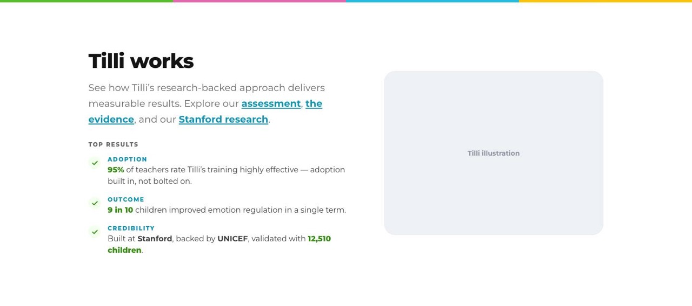

**Current:** H2 *"Tilli works"*. *"95% of teachers rate Tilli's training highly effective — adoption built in, not bolted on."* *"9 in 10 children improved emotion regulation in a single term."*
**Recommended:**
- H2: *"What partner schools have seen so far"*
- Swap the adoption metric: a training rating doesn't show adoption. Use sustained use instead, e.g. *"[X]% of classes still teaching weekly lessons in Term 3"*, or renewals: *"Hippocampus has renewed for three years running."* ⚠️
- Give "9 in 10" a source: *"(teacher-reported, [N] children, [schools], [term/year])"*.

**Why:** "Teachers always rate the training highly on day two. What I need to know is whether they're still teaching it in February."

---

### SC-03 · Hippocampus · P2 · Language ⚠️
- [ ] Done

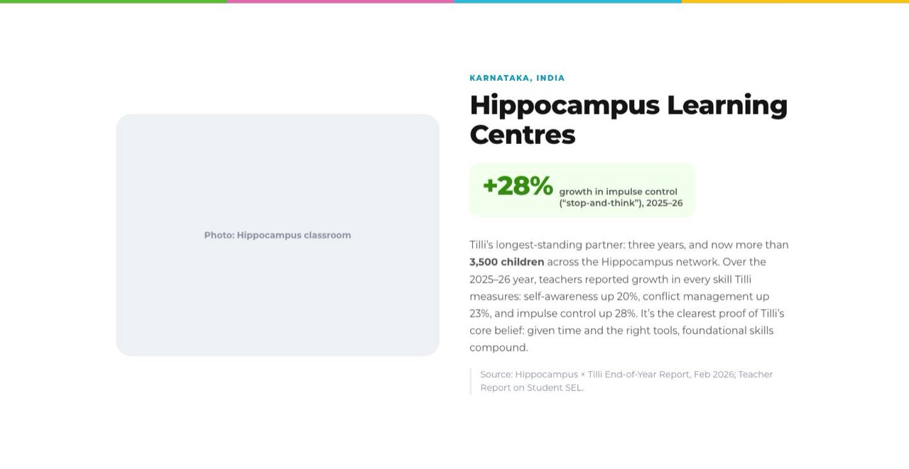

**Current:** *"+28% growth in impulse control ('stop-and-think'), 2025–26"*
**Recommended:**
- Clarify the stat: *"+28% in teacher-rated impulse control, start to end of 2025–26, across [N] children."* ⚠️ Say whether it's percentage points or relative growth.
- Add one line on what kind of schools these are, so readers can compare fairly. ⚠️
- Add a one-sentence quote from a Hippocampus teacher or leader.

**Why:** "28% of what? My CFO will ask that, so I need to be able to answer."

---

### SC-04 · NMAJS: internal note on the page · P1 · Language
- [ ] Done

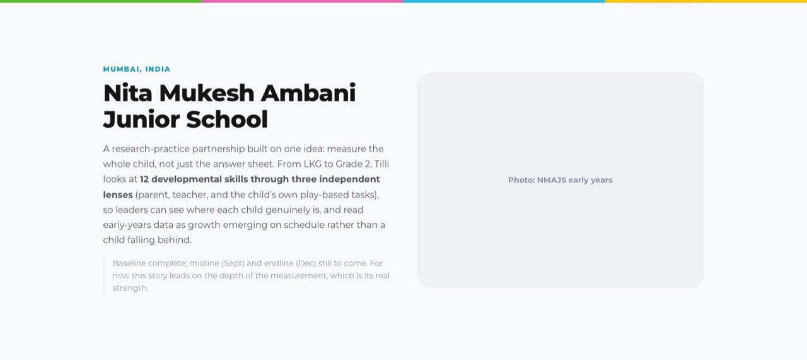

**Current:** *"Baseline complete; midline (Sept) and endline (Dec) still to come. **For now this story leads on the depth of the measurement, which is its real strength.**"*
**Recommended:** *"Baseline completed [month 2026]. Midline results are in analysis; endline follows in December."* ⚠️ Update it: September has already passed.

**Why:** "That last sentence reads like a note from your marketing team. If drafts go out to the public, I wonder what goes out to schools."

---

### SC-05 · Musaeus: internal note on the page · P1 · Language
- [ ] Done

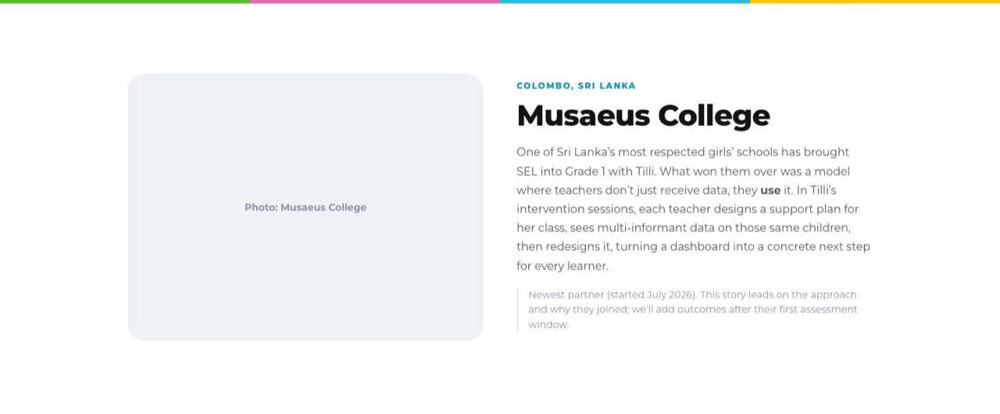

**Current:** *"Newest partner (started July 2026). **This story leads on the approach and why they joined; we'll add outcomes after their first assessment window.**"*
**Recommended:** *"Started July 2026 with Grade 1. First results expected after the [month] assessment."*

---

### SC-06 · NEW STORY: a school like mine · P1 · Section ⚠️
- [ ] Done

**Recommended:** If any of the 53 schools is a CBSE school in a metro, add even a short card: school type, grades, one number, one quote. If there isn't one yet, say so and invite schools in: *"Looking for founding CBSE partners in Bangalore, Delhi NCR and Pune."* ⚠️

**Why:** "The first thing I'll ask on the call is whether you've done this in a school like mine. The page should answer before I have to."

---

### SC-07 · Placeholder images · P1 · Asset
- [ ] Done

The "Tilli illustration", "Photo: Hippocampus classroom", "Photo NMAJS early years" and "Photo: Musaeus College" boxes are still grey placeholders (see SC-02 to SC-05 screenshots). Also see the Home carousel in HM-12.

---

### SC-08 · Contact block · P2 · Language
- [ ] Done

**Current:** "Partner with us / book a demo" → kavindya@. "Press & media" → info@. "General enquiries" → info@ (same address twice) + *+1 650‑334‑7904*.
**Recommended:** List schools first: *"Schools: book a 30-minute call · WhatsApp [number]"*. Merge the two info@ rows into *"Press & general: info@tillikids.com"*. Add an Indian or regional number. ⚠️

---

### SC-09 · Final CTA · P2 · Language
- [ ] Done

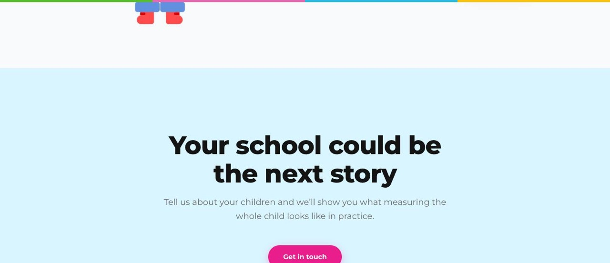

**Current:** *"Your school could be the next story. Tell us about your children and we'll show you what measuring the whole child looks like in practice."*
**Recommended:** Keep the H2. New sub: *"Start with one grade for one term. Your own baseline will show you whether it's working."* (match GL-03)

---

## FAQs (`faq.html`)

### FQ-01 · Hero · P3 · Language
- [ ] Done

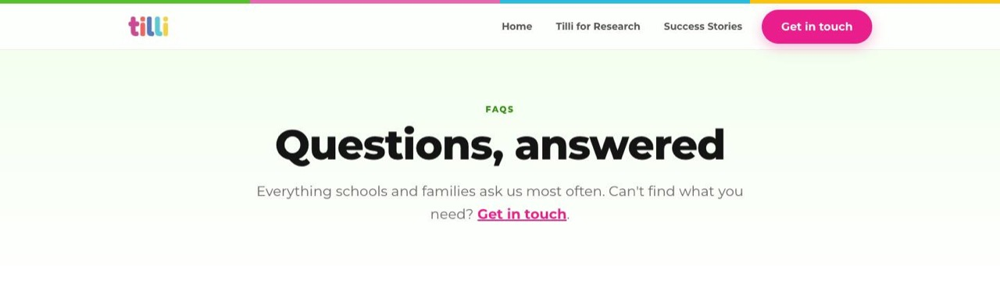

**Current:** *"Everything schools and families ask us most often."*
**Recommended:** *"The questions principals ask us before they start."*

---

### FQ-02 · NEW QUESTIONS · P1 · Section ⚠️
- [ ] Done

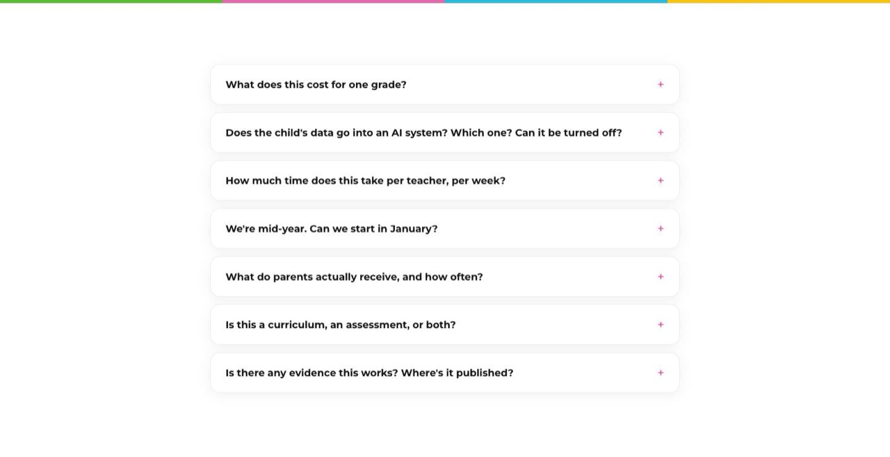

The 7 existing answers are the most credible writing on the site. These are the questions I'd still ask on the call:

| # | Question to add | Answer should cover |
|---|---|---|
| a | Which grades and boards does Tilli work with? | Pre‑K–5 ⚠️; CBSE/ICSE/IB/Cambridge/state; never touches board-exam years |
| b | Our classes have 35–40 children. Does that change anything? | Assessment time at 35; lessons designed for large classes ⚠️ |
| c | We already have a counsellor and a Life Skills period. Is this extra? | Same copy as HM-15 |
| d | What happens when a trained teacher leaves? | Onboarding for new teachers mid-year; materials stay with the school ⚠️ |
| e | Where is our children's data stored, and who can see it? | DPDP Act 2023, parental consent, storage location, nothing sold ⚠️ |
| f | Will our data end up in Tilli's research dataset? | Opt-in only, de-identified, no school names ⚠️ (see RS-03) |
| g | What does training involve, and who delivers it? | In-person or online, language, who runs it ⚠️ |
| h | Can we do a pilot first? | Same wording as GL-03 |
| i | What do I take to my Management Committee? | School leader one-pager, sample dashboard, sample parent report |

---

### FQ-03 · "How much time" answer · P2 · Language ⚠️
- [ ] Done

**Current:** *"We won't claim this replaces something. In most schools it doesn't."*
**Recommended:** *"Most schools teach the lessons inside an existing Life Skills, Value Education or circle-time period, so nothing else on the timetable moves."* ⚠️ Also update "2.5 hours" to match HM-06 (class of 35 ≈ 3 hours a term).

**Why:** "'Doesn't replace anything' makes me hear 'adds something'. Tell me which period it goes into."

---

### FQ-04 · Cost example · P3 · Language
- [ ] Done

**Current:** *"For a grade of 60 children, one year is around ₹1.8 lakh."*
**Recommended:** Add a second example that matches how schools think: *"e.g. Grade 2 with 3 sections of 35 (105 children): around ₹3 lakh."* Also add one line on what's included (training, kits, reports, Ask-Tilli). ⚠️

---

### FQ-05 · Order · P3 · Section
- [ ] Done

**Current order:** Cost → AI/data → Time → Mid-year → Parents → Curriculum vs assessment → Evidence.
**Recommended:** Cost → **Time per teacher** → Evidence → Data/AI → Parents → Grades & boards (new) → the rest. Put the adoption question second, because it's the second thing I'd ask.

---

## TILLI FOR RESEARCH (`research.html`)

*This page isn't written for me, but it's in the header, so I will click it.*

### RS-01 · Signpost for school leaders · P2 · Section
- [ ] Done

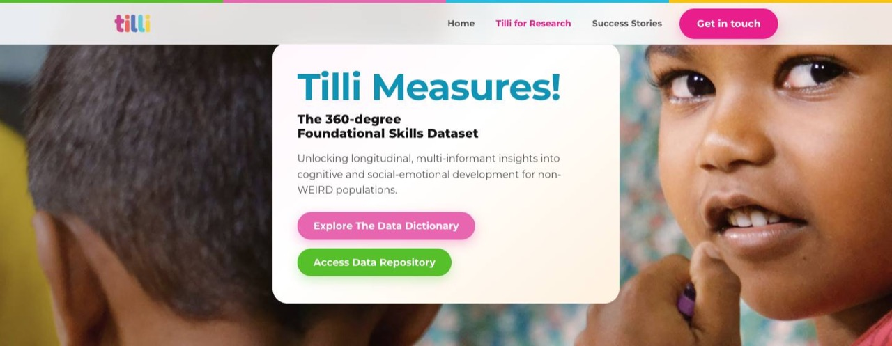

**Recommended:** Add a slim line above or under the hero: *"Are you a school leader? This page is for researchers. **See how Tilli works in schools →**"*

---

### RS-02 · Exclamation-mark headings · P2 · Language
- [ ] Done

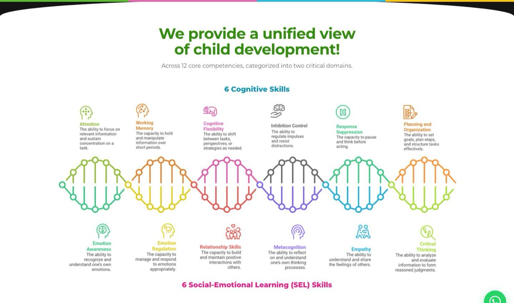

| Current | Recommended |
|---|---|
| "Tilli Measures!" | "The Tilli Foundational Skills Dataset" |
| "We provide a unified view of child development!" | "A unified view of child development" |
| "Resources and More!" | "Resources" |
| "Other Domain and Parameters" | "Other domains and parameters" |

**Why:** "Exclamation marks make a research page read like a brochure, and it's the page that should feel the most rigorous."

---

### RS-03 · Open dataset: consent statement · P1 · Language ⚠️
- [ ] Done

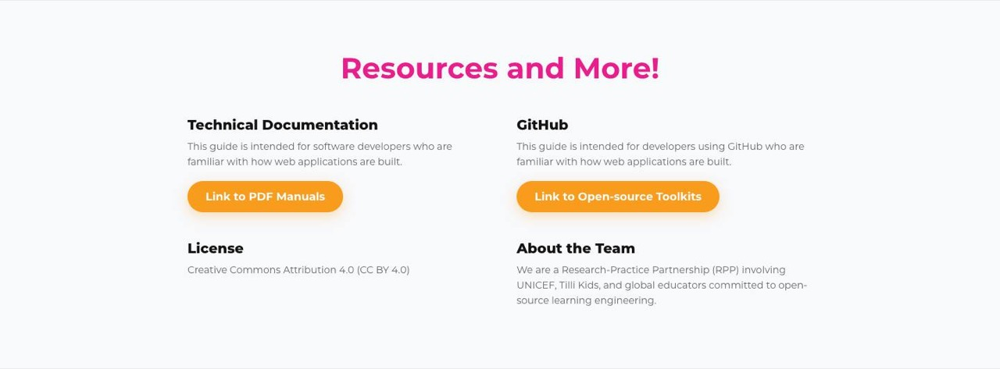

**Current:** The dataset is described as open (*"Creative Commons Attribution 4.0"*, *"Access Data Repository"*). The only privacy line is *"All data is de-identified, privacy-first…"*.
**Recommended:** Add a clear statement:
> *"Partner-school data is included only with the school's and parents' consent. It is de-identified, with no child names and no school names. A school can opt out of the research dataset without affecting its programme."* ⚠️ This must match actual policy and the privacy policy.

**Why:** "I read 'open dataset' and immediately wonder whether my students' data ends up public. One unanswered question like that and I'm out."

---

### RS-04 · Skill names don't match Home · P2 · Language
- [ ] Done

**Current:** Research says "Inhibition Control" and "Response Suppression". Home says "Inhibition: Distraction" and "Inhibition: Response".
**Recommended:** Use one set of 12 names everywhere: Home, Research, reports and the one-pager. The research image itself may need re-exporting.

---

### RS-05 · Copy fixes · P3 · Language
- [ ] Done

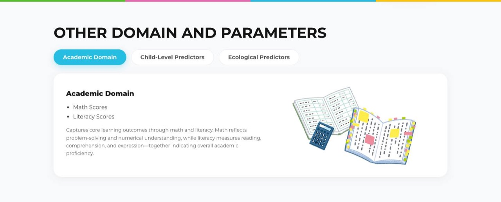

| Current | Recommended |
|---|---|
| "Zip code of the school" / "Home zip code" | "PIN / postal code" |
| "Link to PDF Manuals" | "Download the technical manual (PDF)" |
| "Link to Open-source Toolkits" | "View the open-source toolkit on GitHub" |
| GitHub description repeats the Technical Documentation description word for word | Write a one-line description specific to GitHub |
| Hero sub: "…for non-WEIRD populations" | "…for children in South Asia and other under-represented contexts" (keep W.E.I.R.D. in the section below, where it's explained) |

---

### RS-06 · Partners named inconsistently · P2 · Language
- [ ] Done

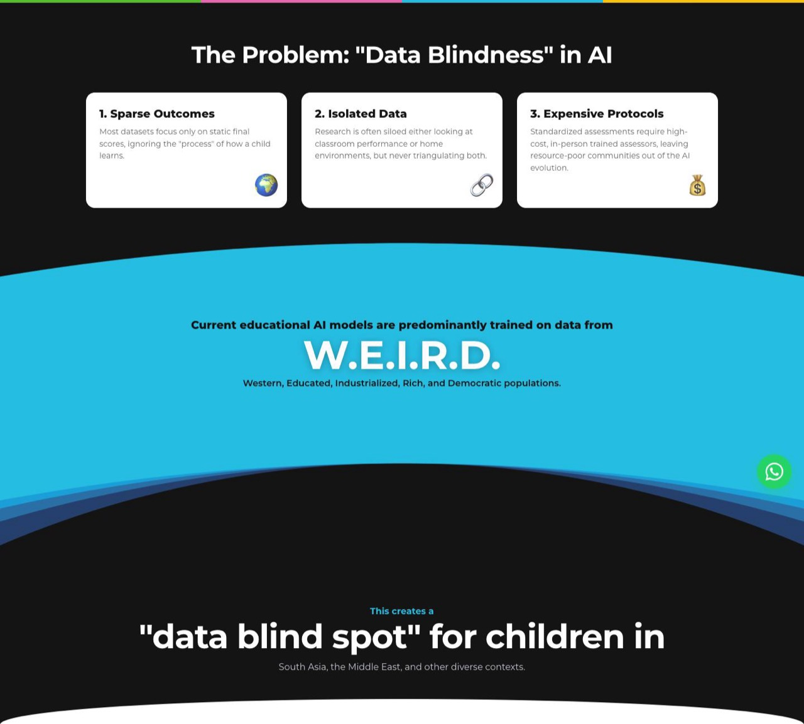

**Current:** About the Team: *"a Research-Practice Partnership (RPP) involving UNICEF, Tilli Kids, and global educators."* Home and FAQ: *"research-practice partnership with Stanford."*
**Recommended:** Name the same partners everywhere: *"A research-practice partnership between Tilli, Stanford Graduate School of Education and UNICEF, with partner schools across South Asia."* ⚠️

---

*Not reviewed:* Privacy Policy (legal copy). Mobile layouts were not screenshotted, but they share this copy, so every change applies to `m/` too.
